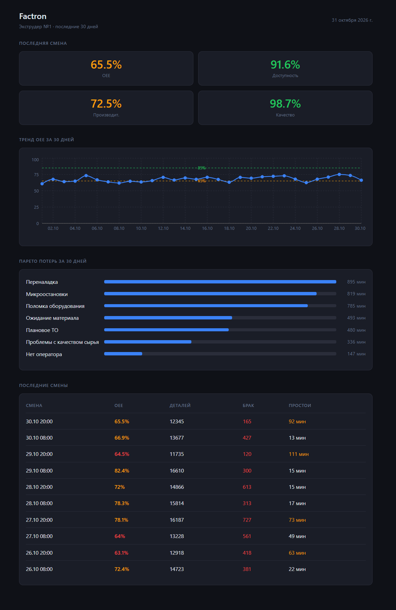
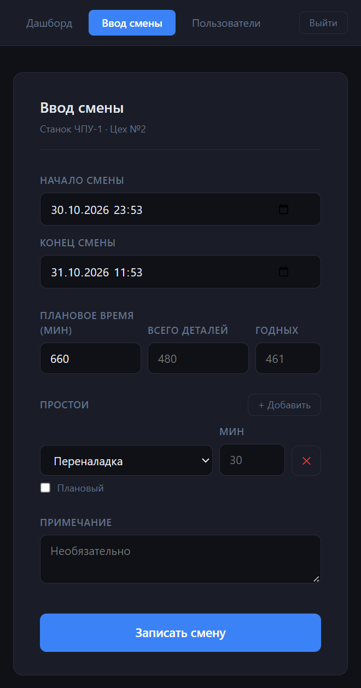
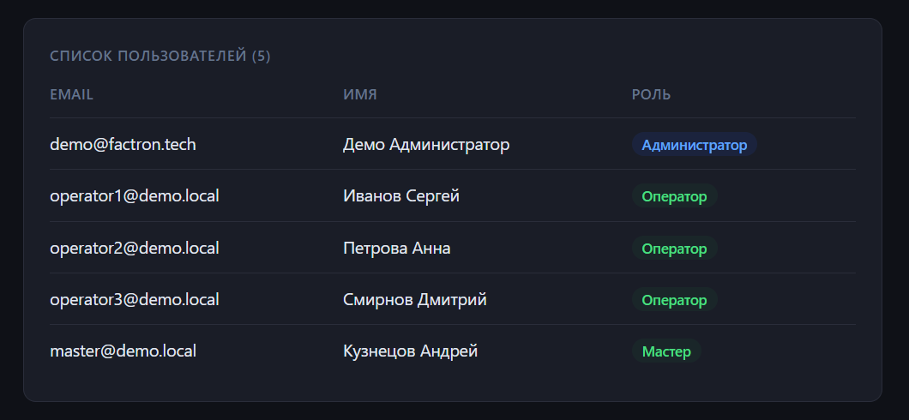

# 🏭 Factron — SaaS для мониторинга OEE на небольших производствах

**Продуктовый кейс.** Код проекта закрыт; здесь — проблема, сегмент, решения и то, как продукт выглядит.

FastAPI · React · PostgreSQL · Redis · Docker Compose



---

## Проблема

**OEE** (Overall Equipment Effectiveness = доступность × производительность × качество) — главная метрика эффективности оборудования. Её считают почти все крупные заводы, но не небольшие.

До IT я работал начальником производства и руководил проектами цифровизации (SCADA-мониторинг). Видел разрыв изнутри:

| Сейчас | Проблема |
|---|---|
| **Excel и бумажные сменные рапорты** | Данные приходят с опозданием, считаются по-разному, потери не видны по причинам |
| **SCADA / MES** | Дорого, долго внедрять, нужна интеграция с каждым станком — неподъёмно для завода на 50–500 человек |

**Гипотеза:** небольшим производствам нужен простой инструмент между Excel и SCADA — сменный ввод с телефона, автоматический расчёт OEE и наглядная картина потерь, без интеграции с оборудованием на старте.

## Сегмент и CustDev

- **Целевой сегмент:** российские производства на 50–500 сотрудников, которые уже переросли Excel, но не готовы к SCADA/MES.
- **Интервью** (3): начальник производства, мастер, менеджер по продажам.
- **Что узнал:** продажам нужен не OEE, а план/факт по их заказам и раннее предупреждение о срыве сроков — это другая задача. **Решение:** убрал продажи из целевых пользователей и сфокусировался на производственном персонале — начальник производства, мастера, механики.

## Решение

### Дашборд — для начальника производства и мастеров
Скриншот выше.
- OEE и три его составляющие по последней смене
- Тренд OEE за 30 дней с ориентирами: **65%** — типичный уровень, **85%** — мировой класс
- **Парето потерь** — какие причины простоев съедают больше всего времени. Это главный экран для решений: что чинить первым
- Последние смены: детали, брак, простои

### Ввод смены — для оператора, с телефона


- PWA: открывается в браузере телефона, без установки приложения
- Время смены, выпуск и годные, простои по причинам (плановые и внеплановые) — OEE считается автоматически
- Справочник причин простоев — свой у каждой организации

### Пользователи и роли


Четыре роли: **администратор, начальник (manager), мастер, оператор** — каждый видит и делает своё.

## Продуктовые решения

- **Ручной ввод вместо интеграции на старте.** Интеграция с оборудованием — главный барьер SCADA. Сменный рапорт с телефона даёт ценность с первого дня. Автоматические источники данных (MQTT, OPC UA, 1С) заложены в модель данных и включаются по мере роста клиента.
- **SaaS, мультитенантность.** Одна инсталляция — много заводов, у каждой организации свои данные, оборудование, причины простоев и пользователи.
- **14-дневный триал с полным функционалом.** Ценность OEE видна только на своих данных за несколько недель — урезанный триал её не покажет.
- **Лендинг со сбором заявок** с учётом 152-ФЗ.
- **Тарифы** спроектированы под размер производства.

## Архитектура

```
Оператор (PWA) ─┐
                ├─→ nginx ─→ React (Vite) 
Начальник ──────┘        └─→ FastAPI ─→ PostgreSQL
                                    └─→ Redis
```

- Backend: FastAPI (async), SQLAlchemy, Alembic-миграции, JWT-авторизация с ролями
- OEE-движок — отдельный модуль: расчёт доступности, производительности и качества по смене с учётом плановых и внеплановых простоев
- Docker Compose; продакшен-деплой на VPS с HTTPS (Let's Encrypt)

## Статус и честные ограничения

- MVP 1.0 собран и разворачивался на VPS. Сейчас сервер и домен не поддерживаются; скриншоты сняты с локального запуска на синтетических данных (30 дней, 4 линии, 240 смен).
- В MVP дашборд и форма работают с одной единицей оборудования — выбор линии и сводный дашборд по цеху в бэклоге.

## Что дальше

- Сводный дашборд по цеху и выбор оборудования
- Слой интерпретации данных: LLM поверх агрегированных метрик OEE — «что изменилось за неделю и куда смотреть»
- Пилот на реальном производстве

---

**Автор:** Алексей Перевезенцев · [профиль](https://github.com/Perevezentsev) · Telegram [@Perevezentsev](https://t.me/Perevezentsev)
